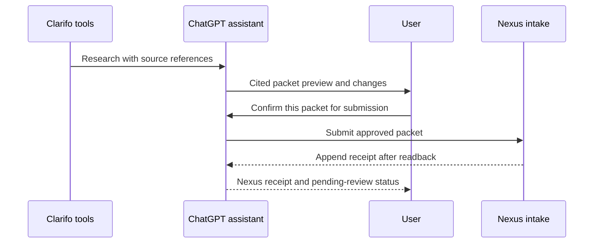

# Clarifo → Nexus handoff design v1

Status: proposed design for review. No Clarifo automation, production write authority, or live handoff is enabled.

## Nexus connection and current boundary

Nexus Capital Map #DOT #SLK is the active capital research project. Canonical Supabase currently has only the `supabase_sandbox` adapter, which has no canonical write authority. The Clarifo packet table is read-only to Command Tower; `service_role` has SELECT but no direct INSERT. The append RPC and Edge Function in PR #39 were exercised only on a disposable synthetic branch, which has been deleted. No current Clarifo-specific write path exists.

The connected Clarifo tools can research companies and read or save Clarifo workspace items. They do not expose a packet export webhook or an operation that posts research to Nexus.

## Recommended first-version path

Use ChatGPT as the human-controlled bridge between Clarifo's research tools and a Nexus intake operation:

1. **Research:** At the user's request, call Clarifo's company, filings, or financial tools. Preserve citation identifiers and source links returned by those tools.
2. **Assemble:** Build a normalized packet draft. Keep source facts, calculations, assumptions, interpretations, and recommendations in separate sections. Store Clarifo's interpretation as unreviewed research, not as a Nexus decision.
3. **Preview:** Show the ticker, company, research date, packet sections, source count, key changes from the latest Nexus packet, and any missing citations. Preview has no write authority.
4. **Human approval:** Ask for a clear, packet-specific submit instruction after the preview. Approval applies to that displayed packet only.
5. **Submit:** A future private Nexus Intake action sends the approved packet server-to-server to the Nexus Edge Function. The service credential and shared secret remain in server-side secret storage; neither appears in Clarifo, a prompt, browser code, or the packet.
6. **Append and verify:** The function calls only the bounded append RPC. It then reads back the returned packet ID and verifies ticker, key, pending-review state, and disabled promotion/trade flags.
7. **Receipt:** Return packet ID, ticker, packet key, retrieval time, status, and result. On timeout or uncertain readback, query by packet key and compare every envelope field, the packet JSON, and the stored SHA-256 before returning a receipt. A retry with the same key is accepted only when that verification matches; otherwise return a conflict or unresolved status. Never blindly resubmit changed content.
8. **Human research review:** Nexus reviewers assess evidence separately. Intake does not admit evidence, resolve conflicts, update a thesis, or authorize a trade.

## Packet contract

The transport envelope uses the existing packet-table fields:

- `packet_key`: stable idempotency key derived from ticker, packet schema version, and canonical packet content hash.
- `adapter_version`: `clarifo_nexus_adapter_v2`.
- `ticker`, `company_name`, `instrument_type`, `research_lane`, plus `market` and `cik` when known.
- `packet_json`: one versioned, cited Clarifo packet.
- `content_hash`: lowercase SHA-256 stored in its own table column, outside `packet_json`, over the PostgreSQL JSONB serialization of an object containing the key, adapter version, all envelope metadata (including nullable `market` and `cik`), and the full packet JSON. It is not embedded inside packet_json, avoiding a circular hash. The proposed SQL adds a nullable hash column for compatibility with historical rows; rows without a hash fail closed on retry reconciliation. The SQL function computes and stores it before insert, then recomputes and compares it against the immutable stored metadata and JSON on duplicate. The Edge Function verifies the full readback and that the RPC hash equals the stored hash.

Minimum `packet_json` sections:

- `facts[]`: metric, value, unit, period, source reference ID, and citation text or location.
- `calculations[]`: result, formula, input fact IDs, and calculation timestamp.
- `assumptions[]`: statement, owner, and as-of date.
- `interpretations[]`: claim, supporting fact IDs, opposing evidence IDs, and status `unreviewed`.
- `recommendations[]`: Clarifo's output, clearly labeled as research output with no execution authority.
- `source_refs[]`: Clarifo page/source IDs, title, URL, document type, publication or filing date, and the facts each source supports.
- `limitations[]`: missing periods, incomplete coverage, unresolved entity mapping, stale inputs, and other caveats.
- `packet_meta`: schema version, Clarifo tool names, retrieval time assigned by Nexus, and requested scope. The envelope content hash is stored separately in the packet table.

Do not invent page IDs or citations. Reject or hold claims whose source references cannot be resolved. Financial facts remain in the packet JSON in v1; normalized writes to `clarifo_evidence_items` and `clarifo_financial_facts` are a later, separately reviewed phase.

## Nexus state guarantees

Every accepted packet is appended with:
- `evidence_status = evidence_open`
- `review_status = pending_human_review`
- `thesis_promotion_allowed = false`
- `trade_action_allowed = false`

A repeated `packet_key` never updates a row. An identical retry returns the original ID only after metadata, JSON, and hash verification. Reuse of the key with any different content or metadata is a conflict. The unique constraint serializes concurrent attempts; after a collision, the function locks and verifies the winning row. The adapter does not supersede old packets, write evidence-adjudication records, change research cards, or write portfolio or broker state. The database assigns `retrieved_at`; source dates stay in the packet.

## Proposed tool boundary

A future private Nexus Intake connector should expose two narrowly scoped actions:

1. `preview_clarifo_packet`: validate required metadata and citation structure, compute the packet hash, compare against the latest packet, return a human-readable preview, and write nothing.
2. `submit_clarifo_packet`: accept only a short-lived preview token tied to the exact packet hash and an explicit user confirmation; invoke the Edge Function; return a readback receipt. Reject changed packet content, expired tokens, duplicate keys with mismatched content, and missing source references.

The existing Edge Function draft accepts a direct authenticated POST but does not yet implement the preview token or a ChatGPT-facing tool. It must be reviewed and adapted to this two-step contract before any production deployment. Data API exposure for RPC remains unverified. Clarifo provides no webhook in the connected tool surface, so v1 is user-triggered and ChatGPT-mediated, not a background Clarifo-to-Nexus sync.

## Acceptance gates

Before production:
1. Decide and document the packet JSON schema and source-reference rules.
2. Implement the private preview/submit connector and its server-side authentication; keep Supabase service credentials out of the client.
3. Verify Nexus schema RPC exposure or use a separately approved invocation route.
4. Security-review the SECURITY DEFINER RPC, grants, owner, search path, constraints, logging, and duplicate-race behavior.
5. Invoke in a faithful development environment using synthetic packets; test preview-only behavior, confirmation binding, identical retry, conflicting payload, concurrent duplicate, uncertain response reconciliation, rejected inputs, and full metadata/content-hash readback.
6. Add a registry row as `verification_required` with no allowed operations until checks pass. Record security and end-to-end verification events with evidence references.
7. Only after human governance approval, enable exactly one operation: append a Clarifo packet pending human review.

## Explicit non-goals

No automatic research schedule, Clarifo webhook, unattended packet submission, automatic evidence admission, thesis promotion, trade recommendation approval, order placement, or packet update/delete. The user remains the authority for submission and subsequent interpretation.
